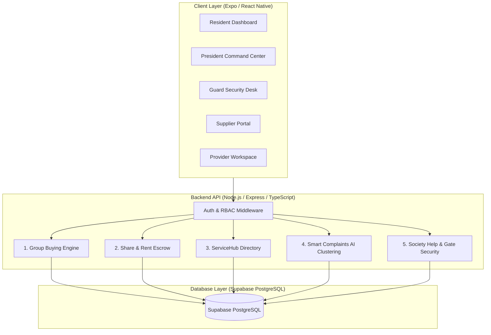

# OneSociety

[](https://www.typescriptlang.org/)
[](https://reactnative.dev/)
[](https://expo.dev/)
[](https://nodejs.org/)
[](https://www.postgresql.org/)
[](https://supabase.com/)
[](https://socket.io/)

> **An all-in-one gated community management and hyperlocal sharing economy platform.**  
> OneSociety unites collective group buying, escrow-secured peer asset rental, verified domestic services, intelligent facility maintenance clustering, and digital gate security into a single role-based mobile ecosystem.

---

## 📌 Problem Statement

Modern apartment societies and gated housing complexes operate in severe economic and operational silos:
1. **Absence of Collective Bargaining**: Individual households independently purchase groceries, produce, and essentials at inflated retail markups, while local wholesale suppliers struggle to aggregate localized urban demand without middleman cuts.
2. **Idle Household Assets & Mistrust**: High-value, rarely used tools (drills, ladders, camping tents) sit idle in private apartments, while neighbours buy duplicate equipment because there is no zero-risk, escrow-secured peer-to-peer lending system.
3. **Unvetted Domestic Workforce**: Sourcing maids, cooks, drivers, and tutors relies on informal word-of-mouth without verified identity checks, attendance tracking, schedule conflict prevention, or formal grievance escalation.
4. **Maintenance Duplication & Clutter**: Common facility failures (elevators, water pumps) trigger dozens of duplicate complaints from angry residents, overwhelming management committees without intelligent clustering or vendor tracking.
5. **Insecure Gate Operations & Financial Opacity**: Gatekeeping still relies on paper logs or one-way visitor registers lacking resident presence detection (*"Nobody at Home"* alerts), while society accounting often lacks digital audit trails and proof of receipts.

---

## 🎯 Target Users & Role Matrix

OneSociety features dedicated, role-tailored interfaces for 5 key stakeholders:

| Role | Accessible Modules & Permissions | Restricted From |
| :--- | :--- | :--- |
| **Resident** | Browse & pledge group orders, borrow/lend items, book domestic help, file grievances, report complaints, toggle home presence, generate guest passes, pay dues. | Guard gate desk, President financial approval queues, supplier bidding. |
| **President (Admin)** | Society command center, open group buy windows, approve supplier bids, release escrow payouts, assign maintenance vendors, audit double-entry ledger & receipts. | Guard scanner operations, supplier quote submissions. |
| **Supplier** | Discover society demand pools, submit wholesale bids with volume tiers, dispatch gate manifests, confirm delivery via gate OTP, track escrow settlements. | Resident modules, gate security console, society ledger. |
| **Security Guard** | Digital security desk, real-time QR pass scanner, "Nobody at Home" presence alerts, manual visitor registry, live inside-society headcount tracking. | Financial accounts, booking rentals, service requests, committee admin. |
| **Service Provider** | Dedicated workspace, manage daily booking requests, weekly time slots, view digital gate pass, track earnings, respond to resident grievances. | Financial ledger, maintenance accounts, guard security console. |

---

## 🚀 Key Modules & Architecture



### 1. Group Buying (Wholesale Hyperlocal Commerce)
- **Demand Pooling**: Residents pledge quantities for bulk goods (e.g., fresh farm produce, groceries).
- **Supplier Bidding**: Verified suppliers submit competitive quotes with volume tier pricing.
- **Escrow Collection**: Resident payments are secured in society escrow until successful delivery.
- **Gate Manifest & Delivery Passes**: Suppliers generate gate delivery manifests; paying residents receive tamper-proof QR passes for pickup verification at the gate.
- **Settlement & Rating**: Automated escrow payouts upon delivery confirmation, with quality dispute arbitration.

### 2. Share & Rent (Neighborhood Peer-to-Peer Lending)
- **Zero Platform Fee**: 100% of rental earnings go to the item owner.
- **Automated Escrow Security Deposit**: Mandatory deposit locked in escrow during the rental period to protect against damage or loss.
- **Photo Handover Inspection**: Both borrower and owner verify item condition at pickup and return.
- **Instant Refund**: Full security deposit automatically refunded upon return confirmation.

### 3. ServiceHub (Skills & Domestic Help Marketplace)
- **Vetted Directory**: Verified domestic staff (maids, cooks, drivers) and resident skill offerings (tutors, fitness trainers).
- **Schedule Conflict Prevention**: Algorithmic validation ensures service providers cannot be double-booked across overlapping flats.
- **Provider Gate Pass**: Active agreements automatically grant service providers valid digital gate entry passes.
- **Grievance Reporting**: Residents can raise formal complaints and performance grievances against service providers directly to the society committee.

### 4. Smart Complaints (Facility Maintenance & Vendor Directory)
- **Duplicate Ticket Clustering**: Algorithmic grouping prevents 30+ residents from filing duplicate tickets when common amenities (e.g., elevator, water pump) break down.
- **Vendor Work Order Dispatch**: Assign registered society technicians with negotiated rates.
- **Mandatory Expense Receipts**: Proof-of-repair photos and invoices are linked directly to society maintenance accounts.
- **Resident Resolution Confirmation**: Affected residents must verify and confirm the fix before a ticket is formally closed.

### 5. Society Help (Gatekeeper Desk, Accounting & Events)
- **QR Gate Pass Scanner**: Fast scanning for family passes, visitor passes, and delivery agents.
- **"Nobody at Home" Alert**: Residents toggle home presence; guards receive immediate warnings if a visitor attempts entry to an unoccupied flat.
- **Integer-Paise Double-Entry Ledger**: Financial records tracked strictly in integer paise (`₹1.00 = 100 paise`) to eliminate IEEE 754 floating-point rounding errors.
- **Mandatory Bill Attachment**: Presidents cannot log society expenditures without attaching invoice photo proof.

---

## 🛠️ Technology Stack

| Layer | Technologies & Tools |
| :--- | :--- |
| **Mobile Client** | React Native, Expo SDK 52, Expo Router v4, React Native Paper (Material Design 3), React Query (TanStack), Zustand |
| **Backend API** | Node.js (>= 20), Express, TypeScript, Zod Schema Validation, Helmet, Cookie-Parser |
| **Database** | PostgreSQL hosted on **Supabase** (Relational schemas, Foreign Keys, ACID transactions) |
| **Realtime & WebSockets** | Socket.IO (Live gate pass validations, instant chat, emergency SOS alerts, group order progress bars) |
| **Internationalization (i18n)** | `i18next` with complete English (`en`), Hindi (`hi`), and Telugu (`te`) localizations |
| **Security & Auth** | JWT (short-lived access tokens + refresh tokens), Argon2 password hashing, RBAC middleware |
| **Payments** | Internal Double-Entry Escrow Ledger with Razorpay integration (test/mock mode) |

---

## 📂 Monorepo Structure

```
OneSociety/
├── apps/
│   ├── mobile/                  # React Native / Expo Mobile Application
│   │   ├── app/                 # Expo Router v4 screens (file-based routing)
│   │   │   ├── (app)/           # Authenticated user flows
│   │   │   │   ├── home/        # Role-based dashboards (resident, president, guard, etc.)
│   │   │   │   ├── group-orders/# Group Buying workflow screens
│   │   │   │   ├── rentals/     # Share & Rent marketplace screens
│   │   │   │   ├── services/    # ServiceHub directory & provider portal
│   │   │   │   ├── complaints/  # Smart complaints & admin ticketing
│   │   │   │   ├── guard/       # Security gatekeeper desk & scanner
│   │   │   │   ├── society-help/# Maintenance accounts, passes, events
│   │   │   │   └── notifications.tsx # Universal deep-linking notification engine
│   │   │   └── (auth)/          # Authentication & login screens
│   │   └── src/                 # Services, state store, i18n locales (en, hi, te)
│   │
│   └── server/                  # Node.js / Express / TypeScript Backend
│       ├── scripts/             # Database seeding scripts (seed-supabase.ts)
│       └── src/
│           ├── modules/         # Modular business domains
│           │   ├── group-buying/
│           │   ├── share-rent/
│           │   ├── service-hub/
│           │   ├── complaints/
│           │   └── society-help/
│           └── shared/          # Auth, notifications, escrow, audit logging
│
├── docs/                        # Project reports, viva guides, and login credentials
└── supabase_schema.sql          # Relational PostgreSQL schema definitions
```

---

## ⚡ Getting Started

### 1. Prerequisites
- **Node.js** >= 20.x
- **npm** >= 10.x
- **Supabase Account** with a PostgreSQL database instance
- **Expo Go** app installed on your smartphone (or an Android/iOS emulator)

### 2. Clone and Install Dependencies

```bash
git clone https://github.com/AmruthaVarshini06/OneSociety.git
cd OneSociety

# Install server dependencies
cd apps/server
npm install

# Install mobile dependencies
cd ../mobile
npm install
```

### 3. Configure Environment Variables

Create `.env` inside `apps/server/`:

```env
PORT=3000
NODE_ENV=development

# Supabase PostgreSQL Configuration
SUPABASE_URL=https://<your-project-ref>.supabase.co
SUPABASE_KEY=your_supabase_service_role_key
DATABASE_URL=postgresql://postgres:<password>@db.<ref>.supabase.co:5432/postgres

# Authentication Secrets
JWT_ACCESS_SECRET=your_jwt_access_secret_at_least_32_chars
JWT_REFRESH_SECRET=your_jwt_refresh_secret_at_least_32_chars
JWT_ACCESS_EXPIRES_IN=15m
JWT_REFRESH_EXPIRES_IN=7d
IDEMPOTENCY_KEY_TTL_SECONDS=86400

# Push & External Alerts (optional / mocked in dev)
FCM_ENABLED=false
WHATSAPP_ENABLED=false
SMS_ENABLED=false
```

Create `.env` inside `apps/mobile/`:

```env
EXPO_PUBLIC_API_URL=http://localhost:3000
EXPO_PUBLIC_SOCKET_URL=http://localhost:3000
```

### 4. Apply Schema & Seed Database

```bash
cd apps/server

# Seed the database with sample society, flats, demo users, items & orders
npm run seed
```

### 5. Run the Application

**Start the Backend Server:**
```bash
cd apps/server
npm run dev
# Server will start on http://localhost:3000
```

**Start the Mobile Application:**
```bash
cd apps/mobile
npx expo start
# Scan the QR code using Expo Go on your mobile device
```

---

## 👥 Demo Logins

The database seed provides pre-configured credentials across all roles:

| Role | Username / Identifier | Password | Description |
| :--- | :--- | :--- | :--- |
| **Resident** | `suresh.kumar` | `password123` | Flat A-102 resident (bookings, group buy, rentals) |
| **President** | `ramesh.naidu` | `password123` | Society Management Committee President |
| **Security Guard** | `guard.gate1` | `password123` | Main Gate 1 digital security desk |
| **Supplier** | `organic.farms` | `password123` | Verified bulk produce supplier |
| **Service Provider** | `sunita.maid` | `password123` | Verified domestic service provider |

---

## 📄 License

This project is licensed under the [MIT License](LICENSE).
