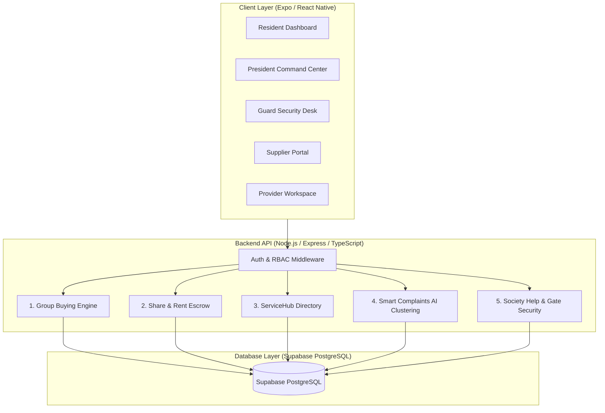

# OneSociety: One App for Every Apartment Need

[](https://www.typescriptlang.org/)
[](https://reactnative.dev/)
[](https://expo.dev/)
[](https://nodejs.org/)
[](https://www.postgresql.org/)
[](https://supabase.com/)
[](https://socket.io/)

> **OneSociety** brings every apartment need into one place, with separate role-tailored logins for residents, the president, security guards, suppliers, service providers, and delivery partners.

---

## 💡 Problem Statement

Modern apartment societies operate on fragmented, informal systems that create daily operational and economic inefficiencies:

• **No Collective Purchasing Power**: Households purchase daily groceries and produce individually at high retail prices instead of pooling bulk community demand directly from verified wholesale suppliers.  
• **Idle Assets & Duplicate Purchases**: Expensive tools and equipment sit idle in private homes, while neighbours buy redundant items due to the lack of an escrow-secured, zero-fee peer lending system.  
• **Unvetted Domestic Help & Scheduling Clashes**: Hiring domestic staff (maids, cooks, tutors) relies on unverified word-of-mouth without schedule conflict prevention or formal grievance escalation.  
• **Redundant Maintenance Complaints**: Common facility failures (elevators, water pumps) trigger chaotic duplicate tickets without intelligent issue clustering or vendor expense tracking.  
• **Insecure Gatekeeping & Financial Opacity**: Security desks lack real-time resident presence verification ("Nobody at Home" alerts), while society maintenance accounting lacks transparent digital receipt audits.  

OneSociety resolves these silos by uniting residents, management committees, security guards, suppliers, and service providers into a single, role-based ecosystem.

---

## 🎯 Target Users

Residents, society presidents, security guards, local suppliers, and service providers in apartment societies and gated communities.

---

## 📄 Abstract

**OneSociety: One App for Every Apartment Need**

Apartment societies still depend on paper registers, WhatsApp groups, and the memory of the president. Families pay higher prices because they buy alone, spend money on items their neighbours already own, and have no trusted way to hire local help or earn from their own skills. Common-area complaints get lost or repeated without priority, visitor entry is unverified, and maintenance finances lack transparency.

OneSociety is a unified mobile application that consolidates every apartment need into an integrated, role-based platform with distinct interfaces for residents, the president, security guards, suppliers, service providers, and delivery partners. The platform is structured around five deeply engineered core modules:

### 1. Group Buying (Wholesale Hyperlocal Demand Pooling)
- **Concept & Value**: Eliminates retail price inflation and aggregator markups by aggregating collective purchasing demand across society households for farm-fresh produce, groceries, and seasonal goods.
- **End-to-End Workflow**: The society president or residents open a demand window with targeted quantities and order deadlines. Residents pledge their desired quantities. Once minimum volume thresholds are satisfied, verified local suppliers and farmers submit competitive wholesale bids featuring volume-discounted tier pricing.
- **Escrow & Gate Verification**: The president selects the optimal offer, and pledged residents pay their share directly into the society's internal escrow ledger. The supplier dispatches the order alongside a gate delivery manifest verified by the security guard upon arrival. The system issues single-use, tamper-proof QR delivery passes to each paying flat for smooth parcel collection at the gate. Escrow payouts are automatically disbursed to the supplier upon pickup confirmation, followed by mutual quality ratings.

### 2. Share & Rent (Zero-Platform-Fee Peer Asset Lending)
- **Concept & Value**: Solves the economic waste of underutilized household assets (power drills, ladders, camping gear, party speakers) by providing an escrow-protected, hyper-local lending network within the residential complex.
- **Zero Platform Fee & Automated Escrow Deposits**: 100% of the rental fee is credited directly to the item owner. To overcome mutual mistrust and eliminate asset damage anxiety, the system requires borrowers to lock an automated security deposit in escrow alongside the rental fee.
- **Inspection & Instant Refund Protocol**: Both lender and borrower capture condition-inspection photos at physical handover. Upon return in undamaged condition, the owner confirms receipt in the app, which immediately triggers an automatic 100% refund of the security deposit back to the borrower while releasing rental earnings to the owner. Contested damages can be escalated to the committee president for photo-backed deposit arbitration.

### 3. ServiceHub (Skills & Domestic Help Marketplace)
- **Concept & Value**: Replaces unvetted, informal domestic hiring with a trusted, committee-verified directory for domestic workers (maids, cooks, drivers) and resident talent (tutors, fitness coaches, music teachers, electricians, plumbers).
- **Verification & Conflict Prevention**: External service providers undergo committee document verification and police check logging before activation. Built-in algorithmic scheduling actively prevents double-booking across overlapping flats, ensuring providers cannot accept conflicting daily work slots.
- **Interactive Negotiation & Gate Clearance**: Residents and providers negotiate job terms, hourly/monthly rates, and daily time slots via an integrated chat with interactive offer cards. Active service contracts automatically generate verified digital gate passes, granting providers seamless entry during authorized work hours.
- **Formal Grievance Escalation**: Provides an integrated grievance reporting channel, enabling residents to file formal complaints and performance reports against service providers directly to society management.

### 4. Smart Complaint Handling (Facility Maintenance & Vendor Directory)
- **Concept & Value**: Eliminates administrative chaos and endless duplicate reporting when common society infrastructure fails (elevators, water pumps, corridor lighting, clubhouse amenities).
- **Intelligent Duplicate Clustering**: Automatically identifies and clusters similar or identical maintenance complaints into a single master ticket. Every resident's post, photos, and descriptions are preserved, while logarithmic clustering formulas raise the issue priority (with instant critical overrides for safety hazards).
- **Vendor Linking & Transparent Invoicing**: The president assigns registered local technicians directly from an integrated vendor directory with pre-negotiated rates. Work order progress, invoices, and photo proof of completed repairs are linked directly to society maintenance accounts.
- **Resident Resolution Confirmation**: Resolved tickets require confirmation from affected residents before being formally archived, ensuring issues are genuinely fixed before closure.

### 5. Society Help (Gate Security Desk & Transparent Financial Ledger)
- **Concept & Value**: Transforms traditional physical gatekeeping and eliminates resident mistrust surrounding society maintenance finances and operational expenditures.
- **Gatekeeper Security Console**: Equipped with real-time QR pass scanning for residents and visitors, a digital manual visitor notepad for walk-ins, and a live in-society headcount counter.
- **"Nobody at Home" Resident Presence Alert**: Residents can toggle their home presence to "Away", which instantly triggers visual warning banners on the guard's tablet if any visitor attempts entry to an unoccupied flat, preventing unauthorized access.
- **Integer-Paise Double-Entry Ledger**: Tracks maintenance fee dues, common utility bills, and guard payroll with absolute mathematical precision using integer paise (`₹1.00 = 100 paise`), eliminating floating-point rounding errors.
- **Mandatory Expense Proof**: Committee administrators cannot log expenditures without attaching photographic receipt or invoice proof, providing complete financial transparency to all society members.

---

The app is built with **React Native**, **TypeScript**, **Node.js**, **Express.js**, **Supabase PostgreSQL**, and **Socket.IO** for live updates, and uses AI for price checks and complaint prioritisation.

OneSociety lowers household costs, reduces waste through sharing, gives local suppliers and service providers steady customers, and builds a safer, more transparent community.

---

## 🚀 Working Prototype

### Features That Work Today:
• **Role-Based Multi-Portal Architecture**: Functional, tailored user interfaces for Resident, President, Supplier, Security Guard, and Service Provider roles with automatic role-gated navigation.  
• **Group Buying Lifecycle**: End-to-end tender creation, resident demand commitment pooling, supplier price bidding, escrow payment collection, delivery manifest validation, pickup QR generation, and escrow payout release.  
• **Share & Rent Marketplace**: Item listing, date-based booking, automated escrow security deposit holds, handover condition confirmation, and instant deposit refund upon return.  
• **ServiceHub & Grievance System**: Service discovery, booking requests with daily time slots and schedule conflict prevention, provider acceptance/negotiation, active agreement gate passes, and a dedicated provider issue reporting workflow.  
• **Smart Complaints Desk**: Complaint lodging with photo proof, category categorization (including staff grievances), status progression, and vendor assignment.  
• **Gatekeeper Guard Console**: "Nobody at Home" resident presence warnings, manual visitor notary, and live in-society headcount tracking.  
• **Transparent Society Ledger**: Integer-paise double-entry accounting ledger with mandatory receipt image attachment for expense transparency.  

### Limitations & Next Steps:
• **Push notifications**: Deep-linking and push delivery are tested through Expo on real devices, not through production iOS and Android push credentials.  
• **QR scanning**: The guard console scans QR passes using the device camera (Expo Camera) on mobile. On desktop, it falls back to manual token entry so the flow can still be tested. *Next step:* None needed for the target use case, since guards use phones or tablets.  
• **Background scheduling**: Auto-closing of expired tenders and the 24-hour return windows run on server-side Node.js timers, which is enough for a single-instance deployment. *Next step:* Move to a distributed job queue so deadlines survive restarts and scale across servers.  
• **Localization**: UI language switches at runtime across English, Hindi, and Telugu, but user-written content such as complaints, listings, and reviews is shown as typed. *Next step:* Machine translation of user content.  

---

## 🛠️ Tech Stack & Dependencies

- **Tech Stack**: React-Native, TypeScript, Node.js, Express.js, Supabase PostgreSQL
- **Dependencies**: Supabase (PostgreSQL), Cloudinary (Image CDN), Socket.IO (WebSockets), Expo Services

---

## 🏛️ System Architecture



---

## ⚡ Quick Start

### 1. Prerequisites
- **Node.js** >= 20.x
- **npm** >= 10.x
- **Expo Go** app on your phone

### 2. Setup & Installation

```bash
git clone https://github.com/AmruthaVarshini06/OneSociety.git
cd OneSociety

# Install dependencies
npm install
cd apps/server && npm install
cd ../mobile && npm install
```

### 3. Run Application

```bash
# Start backend server
cd apps/server
npm run dev

# Start mobile client (in another terminal)
cd apps/mobile
npx expo start
```

---

## 👥 Demo Logins

| Role | Username | Password |
| :--- | :--- | :--- |
| **Resident** | `suresh.kumar` | `password123` |
| **President** | `ramesh.naidu` | `password123` |
| **Security Guard** | `guard.gate1` | `password123` |
| **Supplier** | `organic.farms` | `password123` |
| **Service Provider** | `sunita.maid` | `password123` |


