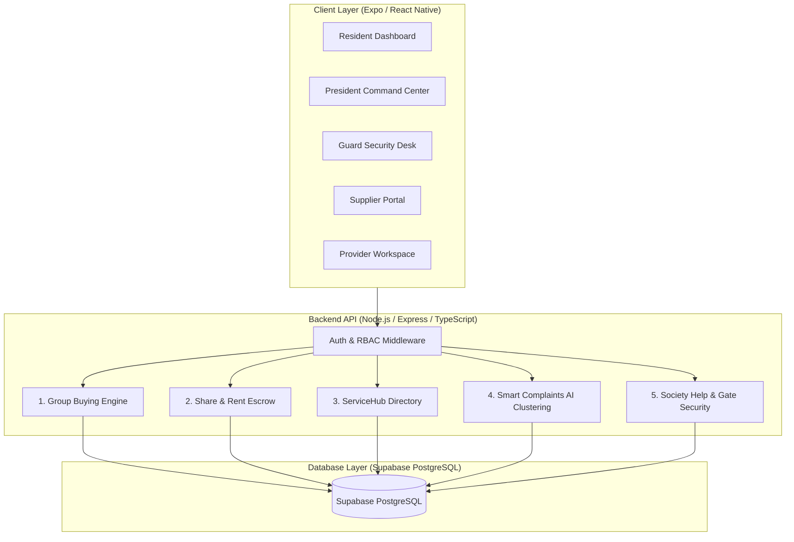

# OneSociety: One App for Every Apartment Need

[](https://www.typescriptlang.org/)
[](https://reactnative.dev/)
[](https://expo.dev/)
[](https://nodejs.org/)
[](https://www.postgresql.org/)
[](https://supabase.com/)
[](https://socket.io/)

> **OneSociety** brings every apartment need into one place, with separate role-tailored logins for residents, the president, security guards, suppliers, service providers, and delivery partners.

---

## 💡 Problem Statement

Apartment societies still run on paper registers, WhatsApp groups, and the memory of the president. As a result, families pay higher prices because they buy alone, spend money on items their neighbours already own, and have no trusted way to hire local help or earn from their own skills. Common-area complaints get lost or repeated without priority, visitor entry has no verification or head-count, and maintenance money is not transparent. There is no single, verified platform where residents, the president, suppliers, service providers, and security work together.

---

## 🎯 Target Users

Residents, society presidents, security guards, local suppliers, and service providers in apartment societies and gated communities.

---

## 📄 Abstract

**OneSociety: One App for Every Apartment Need**

Apartment societies still depend on paper registers, WhatsApp groups, and the memory of the president. Families pay higher prices because they buy alone, spend money on items their neighbours already own, and have no trusted way to hire local help or earn from their own skills. Common-area complaints get lost, visitor entry is unverified, and maintenance money is not transparent.

OneSociety is a mobile app that brings every apartment need into one place, with separate logins for residents, the president, security guards, suppliers, service providers, and delivery partners. It has five core modules:

1. **Group Buying**: Residents pool demand, verified suppliers offer tiered bulk prices, payment is held in escrow, and delivery is confirmed by QR passes.
2. **Share and Rent**: Neighbours lend items for an hourly or daily charge plus a deposit, with AI price verification and photo proof at pickup and return.
3. **ServiceHub**: A marketplace for domestic help, tutoring, music and dance, repairs, fitness, and beauty services, with president-verified providers, chat-based price negotiation, and ratings.
4. **Smart Complaint Handling**: Residents report common-area issues with photos, AI sets the priority, and the president tracks each fix and its cost.
5. **Society Help**: QR-based gate security with headcounts, visitor passes, an at-home status, transparent maintenance accounts, and an event dashboard.

The app is built with **React Native**, **TypeScript**, **Node.js**, **Express.js**, **Supabase PostgreSQL**, and **Socket.IO** for live updates, and uses AI for price checks and complaint prioritisation.

OneSociety lowers household costs, reduces waste through sharing, gives local suppliers and service providers steady customers, and builds a safer, more transparent community.

---

## 🚀 Working Prototype

### Features That Work Today:
• **Role-Based Multi-Portal Architecture**: Functional, tailored user interfaces for Resident, President, Supplier, Security Guard, and Service Provider roles with automatic role-gated navigation.  
• **Group Buying Lifecycle**: End-to-end tender creation, resident demand commitment pooling, supplier price bidding, escrow payment collection, delivery manifest validation, pickup QR generation, and escrow payout release.  
• **Share & Rent Marketplace**: Item listing, date-based booking, automated escrow security deposit holds, handover condition confirmation, and instant deposit refund upon return.  
• **ServiceHub & Grievance System**: Service discovery, booking requests with daily time slots and schedule conflict prevention, provider acceptance/negotiation, active agreement gate passes, and a dedicated provider issue reporting workflow.  
• **Smart Complaints Desk**: Complaint lodging with photo proof, category categorization (including staff grievances), status progression, and vendor assignment.  
• **Gatekeeper Guard Console**: "Nobody at Home" resident presence warnings, manual visitor notary, and live in-society headcount tracking.  
• **Transparent Society Ledger**: Integer-paise double-entry accounting ledger with mandatory receipt image attachment for expense transparency.  

### Limitations & Next Steps:
• **Push notifications**: Deep-linking and push delivery are tested through Expo on real devices, not through production iOS and Android push credentials.  
• **QR scanning**: The guard console scans QR passes using the device camera (Expo Camera) on mobile. On desktop, it falls back to manual token entry so the flow can still be tested. *Next step:* None needed for the target use case, since guards use phones or tablets.  
• **Background scheduling**: Auto-closing of expired tenders and the 24-hour return windows run on server-side Node.js timers, which is enough for a single-instance deployment. *Next step:* Move to a distributed job queue so deadlines survive restarts and scale across servers.  
• **Localization**: UI language switches at runtime across English, Hindi, and Telugu, but user-written content such as complaints, listings, and reviews is shown as typed. *Next step:* Machine translation of user content.  

---

## 🛠️ Tech Stack & Dependencies

- **Tech Stack**: React-Native, TypeScript, Node.js, Express.js, Supabase PostgreSQL
- **Dependencies**: Supabase (PostgreSQL), Cloudinary (Image CDN), Socket.IO (WebSockets), Expo Services

---

## 🏛️ System Architecture



---

## ⚡ Quick Start

### 1. Prerequisites
- **Node.js** >= 20.x
- **npm** >= 10.x
- **Expo Go** app on your phone

### 2. Setup & Installation

```bash
git clone https://github.com/AmruthaVarshini06/OneSociety.git
cd OneSociety

# Install dependencies
npm install
cd apps/server && npm install
cd ../mobile && npm install
```

### 3. Run Application

```bash
# Start backend server
cd apps/server
npm run dev

# Start mobile client (in another terminal)
cd apps/mobile
npx expo start
```

---

## 👥 Demo Logins

| Role | Username | Password |
| :--- | :--- | :--- |
| **Resident** | `suresh.kumar` | `password123` |
| **President** | `ramesh.naidu` | `password123` |
| **Security Guard** | `guard.gate1` | `password123` |
| **Supplier** | `organic.farms` | `password123` |
| **Service Provider** | `sunita.maid` | `password123` |


